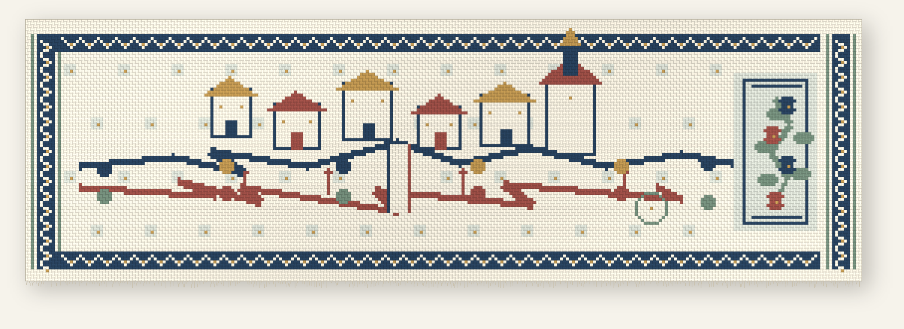

# The Road Keeps Answering

**Hilo de Chamizo · Coded handloom image, 2026**

Indigo, clay red, leaf green, straw, and cotton white. 280 × 88 crossings; rendered with alternating warp and weft, separate motif islands, bound edges, and loose fringe.

Two lines cross a small imagined town and leave a narrow opening at their meeting. The houses, figures, well, and gate are invented; the cloth begins from the thought of a road as a place where another voice can answer. It is a coded woven image, not physical muslin and not a documentary view of Chamizo.

